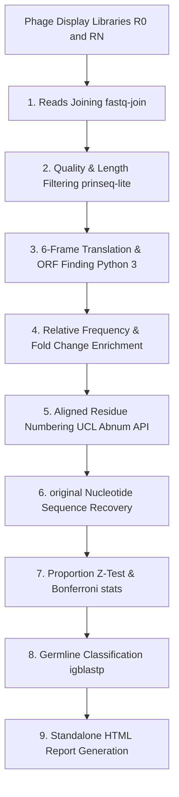

# ATTILA User Guide

<p align="center">
  
</p>

> [!NOTE]
> **Project Readmes:**
> * For the English readme file, see [README.md](README.md).
> * Para consultar o arquivo de documentação em Português, acesse [README.PTBR.md](README.PTBR.md).

---

## 1. About ATTILA

**ATTILA** (**A**utoma**T**ed **T**ool for **I**mmunoglobulin Ana**l**ys**i**s) is a bioinformatics pipeline designed to search and identify candidate immunoglobulin sequences in phage display libraries. The main output of the analysis is a ranked list of candidate variable heavy (VH) and variable light (VL) chain clones selected during rounds of biopanning, identifying the antibody fragments that are highly enriched and most likely to bind the target antigen.

Originally developed in a mixture of Perl scripts, R statistical scripts, and compiled C binaries, the tool has been completely refactored and consolidated into **native Python 3** with a **Bash shell wrapper (`run.sh`)**. This update improves portability across Linux systems (and Windows via WSL), increases step robustness, and removes the need for redundant runtime environments.

### Analysis Workflow
The pipeline processes raw paired-end (or single-end) sequencing reads from initial (R0) and final (RN) rounds of phage display panning through the following sequence:



ATTILA can analyze human immunoglobulin sequences. Because the internal biological selection criteria rely on canonical variable domain residue positions derived from human databases, the pipeline can also analyze mouse sequences, as their framework canonical distances are structurally similar.

---

## 2. Requirements

To install and run ATTILA, your environment must meet the following requirements:

* **Operating System:** macOS, Linux (see supported distributions below), or Windows via WSL.
* **Python Interpreter:** Python `3.8` or higher.
* **External Command-line Tools (must be available in PATH):**
  * `fastqc`: For biological reads quality visualization.
  * `prinseq-lite` (requires a standard system `perl` interpreter).
  * `fastq-join` (or `fastqjoin` executable): For paired-end assembly.
  * `igblastp`: For germline alignment (optional — germline step is skipped if absent).
* **Python Libraries:**
  * `matplotlib` and `numpy` (optional, for native rendering of statistical plots. If they are not found, the script falls back to generating R plot scripts).
* **R Environment (Optional Fallback):**
  * `R` / `Rscript` interpreter version `3.5` or higher.
  * R packages: `ggplot2` and `scales`.
* **Network Connection:** Active internet access is required during pipeline execution to request Kabat numbering from the UCL Abnum online service API.

---

## 3. Installation

You can run ATTILA locally by installing its dependencies or run it containerized via Docker.

### Local Installation — Automated (Recommended)

ATTILA includes `install.sh`, a cross-platform installer that detects your operating system and installs all required tools automatically.

1. Clone or download the ATTILA repository folder:
   ```bash
   git clone https://github.com/waldeyr/attila.git
   cd attila
   ```
2. Run the installer:
   ```bash
   chmod +x install.sh run.sh
   ./install.sh
   ```

The installer supports the following platforms:

| Platform | Package manager | Notes |
| :--- | :--- | :--- |
| macOS | Homebrew (`brew`) | `fastq-join` compiled from source (ea-utils); requires Xcode CLI tools |
| Debian / Ubuntu | `apt` | All tools available as packages |
| RHEL / Fedora / CentOS / Rocky / AlmaLinux | `dnf` / `yum` | EPEL repository enabled automatically |

After installation, `install.sh` automatically runs the pre-flight checks (`TestInstallation`) to confirm everything is in order.

### Local Installation — Manual

If you prefer to install dependencies yourself:

1. Clone the repository:
   ```bash
   git clone https://github.com/waldeyr/attila.git
   cd attila
   ```
2. Install Python dependencies:
   ```bash
   pip install -r requirements.txt
   ```
3. Install CLI tools for your platform:

   **macOS (Homebrew):**
   ```bash
   brew install fastqc
   # fastq-join is not in Homebrew — compile from source or use install.sh
   ```

   **Debian / Ubuntu:**
   ```bash
   sudo apt update && sudo apt install -y fastqc ea-utils perl wget
   ```

   **RHEL / Fedora / CentOS / Rocky / AlmaLinux:**
   ```bash
   sudo dnf install -y epel-release
   sudo dnf install -y fastqc ea-utils perl wget
   ```

   **prinseq-lite (all platforms):**
   Download the Perl script from [SourceForge](https://sourceforge.net/projects/prinseq/) and place it in a directory on your PATH, or let `install.sh` handle it.

   **IgBlast (optional):**
   Download the pre-compiled binary for your platform from the [NCBI FTP](ftp://ftp.ncbi.nih.gov/blast/executables/igblast/release/) and add its `bin/` to your PATH.

4. Grant execution permission:
   ```bash
   chmod +x run.sh
   ```
5. Run the help option to verify basic functionality:
   ```bash
   ./run.sh --help
   ```
6. **Run the built-in verification with synthetic data** to confirm the pipeline works correctly:
   ```bash
   ./run.sh --example
   ```
   Results will be saved to `example_output/example_project_results/`. See [Section 9 — Testing & Verification](#9-testing--verification) for details.

### Containerized Installation (Docker)

Docker is the easiest way to get a fully working ATTILA environment without installing anything on your host. The image is based on `python:3.13-slim-bookworm` and includes all required tools pre-installed and validated.

#### Building the image

From the repository root:
```bash
docker build -t attila:latest .
```

The build automatically runs `python3 programs/test_attila.py TestInstallation -v` as its final step. If any required tool is missing from the image, the build fails immediately with a clear error — so a successful build guarantees a working environment.

#### Running ATTILA with Docker

Mount your working directory with `-v "$(pwd):/app/shared"` to share input files and collect results on your host machine.

| Use case | Command |
| :--- | :--- |
| Verify installation with synthetic data | `docker run --rm -v "$(pwd):/app/shared" attila:latest ./run.sh --example` |
| Interactive configuration wizard | `docker run -it --rm -v "$(pwd):/app/shared" attila:latest ./run.sh --interactive` |
| Run a VH config file | `docker run --rm -v "$(pwd):/app/shared" attila:latest ./run.sh --config /app/shared/my_project_VH.cfg` |
| Run both VH and VL | `docker run --rm -v "$(pwd):/app/shared" attila:latest ./run.sh --config /app/shared/my_project_VH.cfg --type both` |
| Full test suite inside container | `docker run --rm attila:latest python3 programs/test_attila.py -v` |
| Interactive shell | `docker run -it --rm -v "$(pwd):/app/shared" attila:latest bash` |

> **Note on paths inside the container:** ATTILA's working directory inside the container is `/app`. Your mounted host files are at `/app/shared`. Always use `/app/shared/` prefixes when pointing to config files or input data from the host.

---

## 4. Getting Started

### Starting ATTILA
ATTILA relies on a configuration file (`.cfg`) containing library attributes and raw file paths. The pipeline processes one library type (VH or VL) per run. You can configure files manually (using our provided examples) or let the interactive wizard generate them for you.

To start the configuration wizard, execute:
```bash
./run.sh --interactive
```
*(This replaces the older interactive `attilacli.sh` script).*

---

### Running ATTILA with Pre-existing Configuration Files
If you already have your configuration files, you can run the pipeline directly. For instance:

```bash
./run.sh --config myproject_VH.cfg --all
```

#### Run Options:
* `-c, --config FILE`: Specify path to configuration file (`.cfg`).
* `-s, --steps STEPS`: Run only a comma-separated subset of steps (e.g., `--steps filter,translate`). Steps include: `join`, `filter`, `translate`, `frequency`, `number`, `nt-recovery`, `stats`, `germline`, `report`.
* `-t, --type TYPE`: Specify library type override: `vh`, `vl`, or `both`. Using `both` runs the VH and VL configuration files sequentially:
  ```bash
  ./run.sh --config myproject_VH.cfg --type both
  ```
* `-i, --interactive`: Run the interactive wizard to generate new configurations.

---

### Using the Wizard to Create Configuration Files
If you run without options or choose the interactive wizard, ATTILA will ask a series of questions:

1. **Project Name:** The directory name where the analysis results will be saved.
2. **Project Path (where results will be saved):** Directory path on disk where results are compiled.
3. **Reads are paired-end? (y/n, default: y):** Type `y` for paired-end libraries or `n` for single-end.
4. **Input Fastq paths:**
   * **If Paired-End (`y`):** The wizard will ask for the absolute paths of all 8 input files (Forward R1 and Reverse R2 fastq files for R0 and RN libraries of both VH and VL).
   * **If Single-End (`n`):** The wizard will ask for the absolute paths of the 4 input files (R0 and RN fastq files for VH and VL).
5. **IgBlast package path:** The directory containing `bin/igblastp`.
6. **Minimum read length (default: 300):** Reads shorter than this value are discarded during quality filtering.
7. **Minimum base quality (default: 20):** Average Phred score threshold for filtering.
8. **Number of candidates to rank (integer):** The count of candidate clones to be selected and analyzed.

At the end of the input process, the wizard creates two files: `<project_path>/<project_name>_VH.cfg` and `<project_path>/<project_name>_VL.cfg`. It will then ask if you want to execute the analysis immediately.

---

## 5. Running the Analysis

Once execution starts, ATTILA outputs logging statements detailing the subtask in progress, time elapsed, and exit status.

1. It creates the project subdirectory: `<projectdir>/<projectname>`.
2. Standard outputs and script logging are compiled into `<projectdir>/<projectname>/vherror.log` (or `vlerror.log` for VL).
3. Running the full analysis (VH and VL libraries combined) takes typically between 2 to 5 minutes depending on the library sequencing size and your workstation capabilities.

---

## 6. Visualizing Results

ATTILA creates a structured hierarchy within the project directory to compile outputs for both library types and report files:

```
[projectdir]/[projectname]/
├── VH/
│   ├── InitialRound/
│   ├── FinalRound/
│   └── SelectedSequences/
├── VL/
│   ├── InitialRound/
│   ├── FinalRound/
│   └── SelectedSequences/
└── Report/
    ├── Report.html
    ├── plot1vh.png, plot2vh.png, plot1vl.png, plot2vl.png
    ├── vhoutputRstats.txt, vloutputRstats.txt
    └── webpage.log
```

* **`InitialRound/` and `FinalRound/`**: Contain intermediate results such as fastq-joined assemblies, FastQC report files (`.zip` and `.html`), and quality-filtered reads.
* **`SelectedSequences/`**: Contains the variable domains, Kabat numbering text files, recovered DNA segment FASTA files, and the germline database alignment classifications.
* **`Report/`**: Contains the consolidated visual and graphical assets.

---

### What Files Really Matter?

The directory contains many intermediate outputs. Here are the core files containing the final biological data:

* **`Report.html`** (located in `Report/`): The primary visual interactive report containing summary statistics and tables. It requires an active internet connection to load scripts dynamically.
* **`vhlist[N]numbered.fasta` / `vllist[N]numbered.fasta`** (located in `SelectedSequences/`): A FASTA format file containing the variable domain amino acid sequences of candidate clones, Kabat aligned (where `[N]` is your selected candidate list size).
* **`vhlist[N]numberednt.fasta` / `vllist[N]numberednt.fasta`** (located in `SelectedSequences/`): The rescued original nucleotide sequences corresponding to the selected variable domain amino acid candidate clones.
* **`vhSequenceCounting.csv` / `vlSequenceCounting.csv`** (located in the respective library subfolders): A comma-separated values file detailing read abundance progression at each step of the pipeline.
* **`*fastqc.zip`**: The zipped quality control diagnostics generated by FastQC before and after the filtering stage.

---

### Understanding the HTML Report

The interactive report (`Report.html`) is structured with two tabs (one for VH and one for VL). Each tab contains three major sections:

#### A. Reads Information
This section details how many reads were discarded due to low quality or short lengths:
* **Loss of Reads Table:** Percentage of reads filtered out during the pipeline.
* **Proportion of Reads with Adequate Length Chart:** Visualizes reads matching your minimum length threshold (default 300 pb).
* **Total Number of Reads by Task Chart:** A progression bar chart showing read abundance throughout the workflow (Raw -> Joining -> Filtering -> Translation -> Frequency -> Enrichment).

#### B. Candidate Clones
A tabular summary listing Candidate Clones ranked by enrichment metrics:
* **Fold Change:** Ratio of final frequency (RN) versus initial frequency (R0).
* **p-value:** Calculated from a single-tailed Z-test comparing initial and final proportions (using Bonferroni correction adjusted to candidate list size).
* **Confidence Interval (95%):** Precision boundaries for proportion differences.
* **Germline & Identity %:** IgBlast assignment identifying the closest human germline family and the percentage of sequence identity.
* *Note: Hovering over the rank index shows the original FASTA read header.*

#### C. Regions of Variable Domain of Candidate Clones
An aligned tabular view of candidate sequences. Residues are aligned, color-coded, and grouped into antibody structural domains:
* **Framework Regions (FR):** FR1, FR2, FR3, and FR4.
* **Complementarity-Determining Regions (CDR):** CDR1, CDR2, and CDR3.
* *Alignments are calculated based on the Kabat numbering system queried via UCL Abnum.*

---

## 7. Configuration Editing Menu

If you let the interactive wizard build your configuration files and choose not to accept the summary parameters (by typing `n`), the script opens the **Configuration Editing Menu**:

```
---------------------Configuration Editing Menu---------------------------
Project Name (1)
Directory to save project (2)
Reads are paired-end (4)
Path of fastq file of VH R0 paired-end reads r1 (5)
Path of fastq file of VH R0 paired-end reads r2 (6)
Path of fastq file of VH RN paired-end reads r1 (7)
Path of fastq file of VH RN paired-end reads r2 (8)
Path of fastq file of VL R0 paired-end reads r1 (9)
Path of fastq file of VL R0 paired-end reads r2 (10)
Path of fastq file of VL RN paired-end reads r1 (11)
Path of fastq file of VL RN paired-end reads r2 (12)
Path of fastq file of VH R0 single-end reads (13)
...
Minimum Read Length (18)
Mininum Base Quality (19)
Number of Candidates (20)
Save and exit (0)
-------------------------------------------------------------------------
Enter corresponding integer to correct settings:
```

1. Enter the integer matching the parameter you wish to alter.
2. Provide the corrected value when prompted.
3. If changing the paired-end parameter (4), enter `1` for paired-end or `0` for single-end.
4. When finished editing, type `0` to save configurations, exit the menu, and proceed.

---

## 8. Advanced Topic: Executing ATTILA Anywhere

Unlike the original version of ATTILA which required copying helper paths and setting up symbolic links inside your output directory with an external `paths_attila.txt` configuration, the new consolidated Python/Bash workflow dynamically resolves paths automatically.

* The orchestrator script `run.sh` determines the location of its core modules relative to its physical location.
* You can execute the wrapper script from any directory on your system using its absolute path:
  ```bash
  /absolute/path/to/attila/run.sh --config myproject_VH.cfg --all
  ```
* To make ATTILA accessible globally **without symlinks**, add the ATTILA directory to your PATH in your shell profile (`~/.bashrc` or `~/.bash_profile`):
  ```bash
  export PATH="/path/to/attila:${PATH}"
  # Then reload your shell:
  source ~/.bashrc
  # Now you can run from anywhere:
  run.sh --config project.cfg --all
  ```
* Alternatively, create a shell alias in your profile:
  ```bash
  alias attila='/path/to/attila/run.sh'
  ```

---

## 9. Testing & Verification

ATTILA includes an automated test suite to validate the installation environment and all core pipeline components before running on your own data.

### Pre-flight Checks (Automatic)

Every time `run.sh` is executed, it automatically runs the `TestInstallation` class before starting the pipeline. If any required dependency is missing, execution stops with a clear error message and a suggestion to run `./install.sh`.

To run the pre-flight checks manually:

```bash
python3 programs/test_attila.py TestInstallation -v
```

| Check | Behavior if missing |
| :--- | :--- |
| Python ≥ 3.8 | **Fails** — pipeline cannot run |
| `matplotlib`, `numpy` | **Skipped** — optional, pipeline uses R fallback |
| `fastqc`, `prinseq-lite`, `fastq-join` | **Fails** — required for filter/join steps |
| `igblastp` | **Skipped** — optional, germline step skipped |
| `data/genetic_code.fasta` | **Fails** — required for translation |
| `data/germline_human/` | **Fails** — required for germline step |
| `attila.py`, `html_creator.py` importable | **Fails** — core modules |

### Full Test Suite

To run the complete suite (pre-flight checks + unit tests + full integration test):

```bash
python3 programs/test_attila.py -v
```

| Test class | What it verifies |
| :--- | :--- |
| `TestInstallation` | Python version, pip packages, CLI tools in PATH, required data files |
| `TestAttilaPipeline` | DNA functions, 6-frame translation, Z-test statistics, full VH+VL pipeline end-to-end including report generation |

### Quick Smoke Test

To run the pipeline with real data flow using the **built-in synthetic dataset** (no config file required):

```bash
./run.sh --example
```

Results are saved to `example_output/example_project_results/`. Open `example_output/example_project_results/Report/Report.html` in a browser to inspect the output.

---

## 10. References

1. NCBI. Igblast tool. [http://www.ncbi.nlm.nih.gov/igblast/](http://www.ncbi.nlm.nih.gov/igblast/).
2. Jian Ye, Ning Ma, Thomas L Madden, and James M Ostell. Igblast: an immunoglobulin variable domain sequence analysis tool. *Nucleic acids research*, page gkt382, 2013.
3. UCL Abnum Antibody Numbering Service. [http://www.bioinf.org.uk/abs/abnum/](http://www.bioinf.org.uk/abs/abnum/).
4. Prinseq-lite. [https://sourceforge.net/projects/prinseq/](https://sourceforge.net/projects/prinseq/).

---

<p align="center">
  
  &nbsp;&nbsp;&nbsp;&nbsp;&nbsp;&nbsp;&nbsp;&nbsp;&nbsp;&nbsp;&nbsp;&nbsp;&nbsp;&nbsp;&nbsp;&nbsp;&nbsp;&nbsp;&nbsp;&nbsp;&nbsp;&nbsp;&nbsp;&nbsp;
  
</p>

