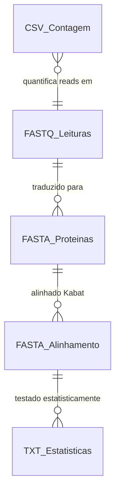
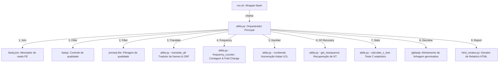

# ATTILA - AutomaTed Tool For Immunoglobulin Analysis

<p align="center">
  
</p>

> [!NOTE]
> **Documentação / Documentation:**
> * Para a versão em inglês deste arquivo, veja o [README.md](README.md).
> * Para consultar o manual de usuário detalhado da ferramenta, acesse o [MANUAL.md](MANUAL.md).

## Publicação Original

Esta ferramenta é uma versão atualizada do ATTILA, originalmente publicado em:

**Discovering Selected Antibodies From Deep-Sequenced Phage-Display Antibody Library Using ATTILA**

Andréa Queiroz Maranhão, Heidi Muniz Silva, Waldeyr Mendes Cordeiro da Silva, Renato Kaylan Alves França, Thais Canassa De Leo, Marcelo Dias-Baruffi, Rafael Trindade Burtet, Marcelo Macedo Brigido

*Bioinformatics and Biology Insights*, 2020. DOI: [10.1177/1177932220915240](https://doi.org/10.1177/1177932220915240)

### Resumo

O Phage display é uma técnica poderosa para selecionar anticorpos de alta afinidade para diferentes finalidades, incluindo biofármacos. O sequenciamento de nova geração (NGS) apresentou-se como uma solução robusta, tornando possível avaliar bilhões de sequências dos domínios variáveis de subbibliotecas selecionadas. Ao lidar com esse processo, uma dificuldade central é encontrar os clones selecionados. Aqui, apresentamos o AutomaTed Tool For Immunoglobulin Analysis (ATTILA), uma nova ferramenta para analisar e encontrar os domínios variáveis enriquecidos ao longo de um experimento de biopanning. O ATTILA é um fluxo de trabalho que combina ferramentas publicamente disponíveis e programas e scripts desenvolvidos internamente para encontrar a frequência de fold-change de amplicons profundamente sequenciados gerados a partir de domínios VH e VL selecionados. Analisamos os mesmos dados de NGS de uma biblioteca humana de Fab usando o ATTILA em 5 experimentos diferentes, bem como em 2 experimentos de biopanning quanto a desempenho, precisão e saída. Essas análises mostraram-se adequadas para avaliar a variabilidade da biblioteca e listar os domínios variáveis mais enriquecidos, pois o ATTILA fornece um relatório com a sequência de aminoácidos de cada domínio identificado, juntamente com suas regiões determinantes de complementaridade (CDRs), classificação de linhagem germinativa e fold change. Por fim, os métodos aqui empregados demonstraram uma maneira adequada de combinar a geração de amplicons e a análise de dados de NGS para descobrir novos anticorpos monoclonais (mAbs).

---

## Resumo do projeto
O **ATTILA** (AutomaTed Tool For Immunoglobulin Analysis) é um pipeline de bioinformática projetado para buscar e selecionar clones candidatos de imunoglobulinas (VH e VL) a partir de bibliotecas geradas por experimentos de Phage Display. Originalmente construído com uma fragmentação de Perl, scripts estatísticos R e binários proprietários em C, o sistema foi inteiramente reescrito e consolidado em **Python 3 nativo** para garantir portabilidade multiplataforma total (Windows, Linux, macOS), robustez na execução de etapas e independência de interpretadores adicionais desnecessários.

## Lista de funcionalidades
1. **Montagem de Leituras Paired-End (Join):** Fusão de sequências forward e reverse em um fragmento único contíguo via `fastq-join`.
2. **Filtragem e Controle de Qualidade (Filter):** Remoção automática de leituras curtas ou de baixa qualidade via `prinseq-lite` e geração de estatísticas visuais via `fastqc`.
3. **Tradução Local em 6 Frames e Detecção de ORFs (Translate):** Tradução nativa em Python das sequências de nucleotídeos para aminoácidos nas 6 janelas de leitura possíveis, filtrando por ORFs de imunoglobulinas válidas contendo Cisteínas conservadas e o motivo FR4 (`WG.G` para VH, `FG.G` para VL).
4. **Cálculo de Frequência Relativa e Enriquecimento (Frequency):** Contagem de abundância dos CDR3 selecionados e cálculo automático do Fold Change de enriquecimento entre a rodada inicial (R0) e final (RN).
5. **Numeração de Resíduos Alinhados (Number):** Acesso automatizado ao esquema de numeração Kabat de anticorpos via UCL Abnum.
6. **Recuperação de Sequências Nucleotídicas (NT-Recovery):** Resgate de nucleotídeos originais correspondentes aos clones selecionados mapeando coordenadas do alinhamento.
7. **Testes Estatísticos de Proporção (Stats):** Cálculo estatístico nativo em Python do teste Z de diferença de proporções e intervalos de confiança de 95% para enriquecimento, aplicando correção de Bonferroni.
8. **Classificação de Linhagem Germinativa (Germline):** Alinhamento e atribuição de genes germinais usando `igblastp`.
9. **Relatório Visual Consolidado (Report):** Compilação de tabelas completas de regiões CDR/FR de clones candidatos, dados de perda de reads e gráficos em um arquivo HTML interativo autônomo.
10. **Demonstração e Verificação do Pipeline (--example):** Geração interna de dados sintéticos e validação imediata do pipeline executando todas as etapas compatíveis com as dependências do ambiente host.

---

# Arquitetura

## Banco de dados
O pipeline opera utilizando o próprio sistema de arquivos em formato estruturado (FASTQ, FASTA, CSV, TXT) para armazenamento das leituras e métricas intermediárias. A representação de dados a seguir detalha esse ecossistema.

### Diagrama de banco de dados


### Dicionário de dados

#### Tabela: FASTQ_Leituras (Arquivos brutos e filtrados .fq/.fastq)
| Campo | Tipo | Descrição |
| :--- | :--- | :--- |
| **id** | TEXT | Identificador exclusivo do read gerado pelo sequenciador (header). |
| **seq** | TEXT | Sequência de nucleotídeos de DNA (bases A, C, T, G, N). |
| **qual** | TEXT | String de qualidade ASCII Phred correspondente a cada nucleotídeo. |

#### Tabela: FASTA_Proteinas (Arquivos traduzidos aa.fasta / nt.fasta)
| Campo | Tipo | Descrição |
| :--- | :--- | :--- |
| **id** | TEXT | Identificador da leitura associado à frame (ex: seq_id\|FRAME:1+). |
| **seq** | TEXT | Sequência completa do domínio variável de aminoácidos traduzidos. |
| **cdr3_seq** | TEXT | Sequência isolada da alça CDR3 identificada. |

#### Tabela: CSV_Contagem (vhSequenceCounting.csv / vlSequenceCounting.csv)
| Campo | Tipo | Descrição |
| :--- | :--- | :--- |
| **library** | TEXT | Nome da biblioteca correspondente (R0, RN ou Selected). |
| **reads** | INTEGER | Quantidade de reads/sequências restantes após processamento. |
| **step** | TEXT | Etapa correspondente do pipeline (raw, joining, filtering, translation, frequency, enrichment, numeration). |

#### Tabela: TXT_Estatisticas (vhoutputRstats.txt / vloutputRstats.txt)
| Campo | Tipo | Descrição |
| :--- | :--- | :--- |
| **id** | TEXT | Identificador do clone candidato. |
| **pvalue** | REAL | P-valor do teste z de proporção unicaudal de enriquecimento. |
| **infIC** | REAL | Limite inferior do intervalo de confiança de 95% da diferença. |
| **supIC** | REAL | Limite superior do intervalo de confiança de 95% da diferença. |

---

## Componentes

### Diagrama de componentes


### Tecnologias e suas versões
| Tecnologia | Versão | Descrição |
| :--- | :--- | :--- |
| **Python** | `3.11+` | Linguagem de orquestração e lógica principal de processamento biológico. |
| **Bash** | `4.0+` | Wrapper amigável de linha de comando para facilitação e setup. |
| **FastQC** | `0.11+` | Controle de qualidade visual de sequências biológicas. |
| **Prinseq-lite** | `0.20+` | Filtragem de qualidade e limpeza de reads por pontuação de qualidade. |
| **Fastq-join** | `1.01+` | Montagem/mesclagem de reads forward e reverse emparelhados (paired-end). |
| **IgBlast** | `1.14.0+` | Alinhamento contra banco de germlines humanas/camundongos. |
| **Matplotlib** | `3.9+` | Plotagem nativa dos gráficos estatísticos no relatório (Opcional - fallback para R). |
| **NumPy** | `2.0+` | Operações numéricas requeridas pelo Matplotlib. |
| **R / Rscript** | `4.0+` | Interpretador alternativo de gráficos estatísticos (Opcional - ggplot2, scales). |
| **Bootstrap** | `5.3.0` | Framework CSS utilizado para o design moderno e responsividade do Relatório HTML. |
| **Bootstrap Icons** | `1.10.5` | Biblioteca de ícones vetoriais utilizada nas seções colapsáveis do relatório. |
| **Google Fonts (Inter)** | `N/A` | Fonte tipográfica moderna e altamente legível utilizada no relatório. |

---

## Funcionalidades

### Requisitos

#### Funcionalidade: Executar Pipeline com Configuração
| Funcionalidade | Campo de formulário / Argumento | Campo de banco de dados / Configuração | Regras aplicadas |
| :--- | :--- | :--- | :--- |
| Orquestração | `--config meu_projeto.cfg` | Arquivo de entrada `.cfg` contendo caminhos. | O arquivo de configuração deve existir e conter caminhos válidos no sistema de arquivos. |

#### Funcionalidade: Controle Modular por Etapas
| Funcionalidade | Campo de formulário / Argumento | Campo de banco de dados / Configuração | Regras aplicadas |
| :--- | :--- | :--- | :--- |
| Execução Modular | `--steps join,filter,translate` | `ATTILA_STEPS` env | O pipeline executará apenas as subetapas especificadas separadas por vírgula. |

#### Funcionalidade: Escolha de Bibliotecas VH/VL
| Funcionalidade | Campo de formulário / Argumento | Campo de banco de dados / Configuração | Regras aplicadas |
| :--- | :--- | :--- | :--- |
| Definição de Cadeia | `--type vh`, `--type vl` ou `--type both` | `libtype` | Permite rodar de forma isolada VH (0), VL (1) ou ambas as configurações de forma sequencial automática. |

#### Funcionalidade: Executar Exemplo de Demonstração
| Funcionalidade | Campo de formulário / Argumento | Campo de banco de dados / Configuração | Regras aplicadas |
| :--- | :--- | :--- | :--- |
| Execução de Demo | `--example` | Detecção de ambiente | Executa sequencialmente as cadeias VH e VL usando dados sintéticos. Ativa automaticamente o modo fallback (apenas etapas Python) caso falte dependências de CLI no PATH. |

---

## Instalação e uso

### Opção 1: Instalação Local

#### Pré-requisitos
* **Python 3.8+**
* **Ferramentas de CLI:** FastQC, Prinseq-lite, Fastq-join e IgBlast (opcional).

#### Instalação automatizada (Recomendado)
O ATTILA inclui um instalador multiplataforma que detecta o sistema operacional e instala todas as dependências automaticamente:

```bash
git clone https://github.com/waldeyr/attila.git
cd attila
chmod +x install.sh run.sh
./install.sh
```

Plataformas suportadas:

| Plataforma | Gerenciador de pacotes | Observações |
| :--- | :--- | :--- |
| macOS | Homebrew (`brew`) | `fastq-join` compilado da fonte (ea-utils) |
| Debian / Ubuntu | `apt` | Todas as ferramentas disponíveis como pacotes |
| RHEL / Fedora / CentOS / Rocky / AlmaLinux | `dnf` / `yum` | Habilita EPEL automaticamente |

> **IgBlast** (etapa de germline) é opcional. O instalador o baixa e instala automaticamente, mas o pipeline funciona sem ele — a etapa de classificação de germline é simplesmente ignorada.

#### Instalação manual
Se preferir instalar as dependências manualmente:

1. Clone o repositório do ATTILA:
   ```bash
   git clone https://github.com/waldeyr/attila.git
   cd attila
   ```
2. Instale as dependências de Python:
   ```bash
   pip install -r requirements.txt
   ```
3. Instale as ferramentas de CLI:
   - **macOS:** `brew install fastqc` (fastq-join precisa ser compilado da fonte — veja `install.sh`)
   - **Debian/Ubuntu:** `sudo apt install fastqc ea-utils perl`
   - **RHEL/Fedora/Rocky:** `sudo dnf install epel-release && sudo dnf install fastqc ea-utils perl`
   - **prinseq-lite** (todas as plataformas): baixe o script Perl do [SourceForge](https://sourceforge.net/projects/prinseq/) e coloque-o no seu PATH.
4. Configure as permissões de execução do script wrapper:
   ```bash
   chmod +x run.sh
   ```

#### Execução
Execute o pipeline completo usando um arquivo de configuração:
```bash
./run.sh --config meu_projeto_VH.cfg --all
```

Para rodar apenas etapas específicas:
```bash
./run.sh --config meu_projeto_VH.cfg --steps filter,translate
```

Para iniciar o assistente de configuração interativo:
```bash
./run.sh --interactive
```

Para rodar o pipeline com dados sintéticos de demonstração e verificar a instalação:
```bash
./run.sh --example
```
*Nota: Caso as ferramentas `fastqc` ou `prinseq-lite` não estejam presentes no seu PATH, o script ativará de forma automática o modo fallback, copiando arquivos FASTA sintéticos pré-filtrados e rodando as etapas exclusivas de processamento Python. Isso assegura que você consiga validar e explorar o relatório de saída do pipeline sem precisar instalar ferramentas de bioinformática adicionais. Os resultados são salvos em `example_output/example_project_results/`.*

---

### Verificação e Testes

O `run.sh` executa automaticamente verificações de pré-instalação antes de cada execução. Para rodar as verificações manualmente:

```bash
python3 programs/test_attila.py TestInstallation -v
```

Para rodar a suíte completa de testes (unitários + integração):

```bash
python3 programs/test_attila.py -v
```

| Classe de teste | O que verifica |
| :--- | :--- |
| `TestInstallation` | Versão do Python, pacotes pip, ferramentas CLI no PATH, arquivos de dados obrigatórios |
| `TestAttilaPipeline` | Funções de DNA, tradução em 6 frames, estatísticas Z-test, pipeline completo VH+VL de ponta a ponta |

#### Suíte de testes para desenvolvimento (pytest)

O diretório `tests/` contém uma suíte pytest mais ampla. Ela verifica valores calculados (detecção da CDR3, fold changes, p-valores e intervalos de confiança do z-test, contagens de reads, conteúdo do relatório HTML) e executa o pipeline completo sobre os dados sintéticos com as ferramentas externas e o serviço Abnum simulados, sem precisar dos binários de bioinformática nem de acesso à rede.

```bash
python3 -m venv .venv
.venv/bin/pip install -r requirements-dev.txt
.venv/bin/pytest                       # testes unitários + ponta a ponta simulados
.venv/bin/pytest -m tools              # roda também prinseq-lite, fastqc e igblastp reais (pulados se ausentes)
.venv/bin/pytest --cov=programs --cov-report=term-missing
```

Defeitos conhecidos estão registrados em `tests/test_known_bugs.py` como testes `xfail` estritos (aparecem como `XFAIL`). Quando um defeito for corrigido, o teste correspondente passa e é reportado como falha até que o marcador `xfail` seja removido.

---

### Opção 2: Executando com Docker (Recomendado para ambientes reproduzíveis)

O Docker encapsula todas as dependências de bioinformática (FastQC, prinseq-lite, fastq-join, IgBlast e dependências Python), eliminando a necessidade de qualquer instalação manual local. A imagem é baseada em `python:3.13-slim-bookworm` e o build valida automaticamente todas as ferramentas via `TestInstallation`.

#### Construindo a Imagem Docker
A partir do diretório raiz do repositório, execute:
```bash
docker build -t attila:latest .
```

> O build executa `python3 programs/test_attila.py TestInstallation -v` como etapa final. Se alguma ferramenta obrigatória estiver ausente da imagem, o build falha com uma mensagem clara.

#### Rodando com Docker

Monte seu diretório de trabalho com `-v` para que os arquivos de entrada e resultados sejam acessíveis no seu computador.

##### A. Verificar a instalação com dados sintéticos de demonstração:
```bash
docker run --rm -v "$(pwd):/app/shared" attila:latest ./run.sh --example
```
Os resultados são salvos no container em `/app/example_output/` e espelhados em `$(pwd)/example_output/` no seu host.

##### B. Iniciar o wizard de configuração interativo:
```bash
docker run -it --rm -v "$(pwd):/app/shared" attila:latest ./run.sh --interactive
```
Salve o projeto dentro de `/app/shared` para que os resultados persistam no seu computador.

##### C. Executar um arquivo de configuração:
```bash
docker run --rm -v "$(pwd):/app/shared" attila:latest \
    ./run.sh --config /app/shared/meu_projeto_VH.cfg --type both
```

##### D. Rodar a suíte completa de testes dentro do container:
```bash
docker run --rm attila:latest python3 programs/test_attila.py -v
```

##### E. Abrir um shell interativo dentro do container:
```bash
docker run -it --rm -v "$(pwd):/app/shared" attila:latest bash
```


<p align="center">
  
  &nbsp;&nbsp;&nbsp;&nbsp;&nbsp;&nbsp;&nbsp;&nbsp;&nbsp;&nbsp;&nbsp;&nbsp;&nbsp;&nbsp;&nbsp;&nbsp;&nbsp;&nbsp;&nbsp;&nbsp;&nbsp;&nbsp;&nbsp;&nbsp;
  
</p>

