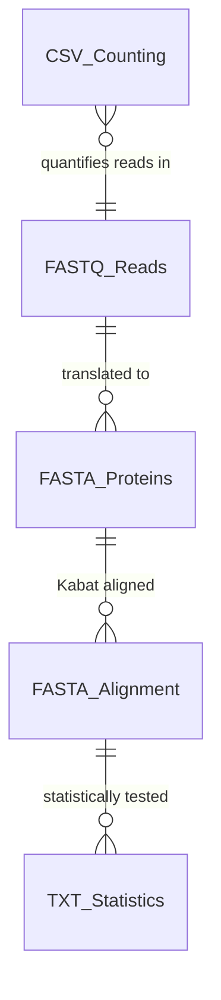
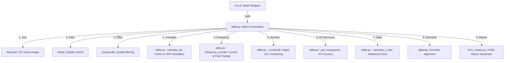

# ATTILA - AutomaTed Tool For Immunoglobulin Analysis

<p align="center">
  
</p>

> [!NOTE]
> **Documentation / Documentação:**
> * For the Brazilian Portuguese version of this file, see [README.PTBR.md](README.PTBR.md).
> * To access the detailed user manual, see [MANUAL.md](MANUAL.md).

## Original Publication

This tool is an updated version of ATTILA, originally published in:

**Discovering Selected Antibodies From Deep-Sequenced Phage-Display Antibody Library Using ATTILA**

Andréa Queiroz Maranhão, Heidi Muniz Silva, Waldeyr Mendes Cordeiro da Silva, Renato Kaylan Alves França, Thais Canassa De Leo, Marcelo Dias-Baruffi, Rafael Trindade Burtet, Marcelo Macedo Brigido

*Bioinformatics and Biology Insights*, 2020. DOI: [10.1177/1177932220915240](https://doi.org/10.1177/1177932220915240)

### Abstract

Phage display is a powerful technique to select high-affinity antibodies for different purposes, including biopharmaceuticals. Next-generation sequencing (NGS) presented itself as a robust solution, making it possible to assess billions of sequences of the variable domains from selected sublibraries. Handling this process, a central difficulty is to find the selected clones. Here, we present the AutomaTed Tool For Immunoglobulin Analysis (ATTILA), a new tool to analyze and find the enriched variable domains throughout a biopanning experiment. The ATTILA is a workflow that combines publicly available tools and in-house programs and scripts to find the fold-change frequency of deeply sequenced amplicons generated from selected VH and VL domains. We analyzed the same human Fab library NGS data using ATTILA in 5 different experiments, as well as on 2 biopanning experiments regarding performance, accuracy, and output. These analyses proved to be suitable to assess library variability and to list the more enriched variable domains, as ATTILA provides a report with the amino acid sequence of each identified domain, along with its complementarity-determining regions (CDRs), germline classification, and fold change. Finally, the methods employed here demonstrated a suitable manner to combine amplicon generation and NGS data analysis to discover new monoclonal antibodies (mAbs).

---

## Project Summary
**ATTILA** (AutomaTed Tool For Immunoglobulin Analysis) is a bioinformatics pipeline designed to search and select candidate clones of immunoglobulins (VH and VL) from libraries generated by Phage Display experiments. Originally built with a combination of Perl, R statistical scripts, and proprietary C binaries, the system has been entirely rewritten and consolidated into **native Python 3** to guarantee full cross-platform portability (Windows, Linux, macOS), robust step execution, and independence from unnecessary additional interpreters.

## List of Features
1. **Paired-End Reads Assembly (Join):** Merging of forward and reverse sequences into a single contiguous fragment via `fastq-join`.
2. **Filtering and Quality Control (Filter):** Automatic removal of short or low-quality reads via `prinseq-lite` and generation of visual statistics via `fastqc`.
3. **6-Frame Local Translation and ORF Detection (Translate):** Native Python translation of nucleotide sequences to amino acids in the 6 possible reading frames, filtering by valid immunoglobulin ORFs containing conserved Cysteines and the FR4 motif (`WG.G` for VH, `FG.G` for VL).
4. **Relative Frequency and Enrichment Calculation (Frequency):** Abundance counting of selected CDR3s and automatic Fold Change calculation of enrichment between the initial round (R0) and final round (RN).
5. **Aligned Residue Numbering (Number):** Automated access to the Kabat numbering scheme of antibodies via the UCL Abnum API.
6. **Nucleotide Sequence Recovery (NT-Recovery):** Retrieval of original nucleotide sequences corresponding to the selected clones by mapping alignment coordinates.
7. **Statistical Proportion Tests (Stats):** Native Python statistical calculation of the single-tailed Z-test of proportion differences and 95% confidence intervals for enrichment, applying Bonferroni correction.
8. **Germline Classification (Germline):** Alignment and germline gene assignment using local `igblastp`.
9. **Consolidated Visual Report (Report):** Compilation of complete CDR/FR region tables for candidate clones, read loss data, and charts into a standalone interactive HTML report.
10. **Pipeline Verification and Demo (--example):** Built-in synthetic dataset generation and pipeline validation that runs all compatible steps based on the host environment dependencies.

---

# Architecture

## Database
The pipeline operates utilizing the filesystem itself in structured formats (FASTQ, FASTA, CSV, TXT) for storing raw reads, intermediate results, and metrics. The data representation below details this ecosystem.

### Database Diagram


### Data Dictionary

#### Table: FASTQ_Reads (Raw and filtered .fq/.fastq files)
| Field | Type | Description |
| :--- | :--- | :--- |
| **id** | TEXT | Unique read identifier generated by the sequencer (header). |
| **seq** | TEXT | DNA nucleotide sequence (A, C, T, G, N bases). |
| **qual** | TEXT | Phred quality ASCII string corresponding to each nucleotide. |

#### Table: FASTA_Proteins (Translated aa.fasta / nt.fasta files)
| Field | Type | Description |
| :--- | :--- | :--- |
| **id** | TEXT | Read identifier associated with the frame (e.g., seq_id\|FRAME:1+). |
| **seq** | TEXT | Full sequence of the translated variable domain of amino acids. |
| **cdr3_seq** | TEXT | Isolated sequence of the identified CDR3 loop. |

#### Table: CSV_Counting (vhSequenceCounting.csv / vlSequenceCounting.csv)
| Field | Type | Description |
| :--- | :--- | :--- |
| **library** | TEXT | Name of the corresponding library (R0, RN, or Selected). |
| **reads** | INTEGER | Number of reads/sequences remaining after processing. |
| **step** | TEXT | Corresponding pipeline step (raw, joining, filtering, translation, frequency, enrichment, numeration). |

#### Table: TXT_Statistics (vhoutputRstats.txt / vloutputRstats.txt)
| Field | Type | Description |
| :--- | :--- | :--- |
| **id** | TEXT | Candidate clone identifier. |
| **pvalue** | REAL | P-value of the single-tailed Z-test of proportion enrichment. |
| **infIC** | REAL | Lower bound of the 95% confidence interval of the difference. |
| **supIC** | REAL | Upper bound of the 95% confidence interval of the difference. |

---

## Components

### Component Diagram


### Technologies and Versions
| Technology | Version | Description |
| :--- | :--- | :--- |
| **Python** | `3.11+` | Orchestration language and main biological processing logic. |
| **Bash** | `4.0+` | Friendly command-line wrapper script for setup and execution. |
| **FastQC** | `0.11+` | Visual quality control of biological sequences. |
| **Prinseq-lite** | `0.20+` | Quality filtering and trimming of reads. |
| **Fastq-join** | `1.01+` | Assembly/merging of paired-end forward and reverse reads. |
| **IgBlast** | `1.14.0+` | Alignment against human/mouse germline databases. |
| **Matplotlib** | `3.9+` | Native plotting of statistical charts in report (Optional - fallback to R). |
| **NumPy** | `2.0+` | Numerical operations required by Matplotlib. |
| **R / Rscript** | `4.0+` | Alternative interpreter for statistical charts (Optional - ggplot2, scales). |
| **Bootstrap** | `5.3.0` | CSS framework used for the modern design and responsiveness of the HTML Report. |
| **Bootstrap Icons** | `1.10.5` | Vector icon library used for collapsible panels in the report. |
| **Google Fonts (Inter)** | `N/A` | Modern font family used to enhance scientific report readability. |

---

## Features

### Requirements

#### Feature: Run Pipeline with Configuration
| Feature | Form Field / Argument | Database Field / Configuration | Applied Rules |
| :--- | :--- | :--- | :--- |
| Orchestration | `--config my_project.cfg` | Input `.cfg` file containing paths. | The configuration file must exist and contain valid paths within the filesystem. |

#### Feature: Modular Control by Steps
| Feature | Form Field / Argument | Database Field / Configuration | Applied Rules |
| :--- | :--- | :--- | :--- |
| Modular Execution | `--steps join,filter,translate` | `ATTILA_STEPS` env | The pipeline will run only the specified comma-separated sub-steps. |

#### Feature: Choose VH/VL Libraries
| Feature | Form Field / Argument | Database Field / Configuration | Applied Rules |
| :--- | :--- | :--- | :--- |
| Chain Definition | `--type vh`, `--type vl` or `--type both` | `libtype` | Allows running VH (0), VL (1) or both configurations sequentially and automatically. |

#### Feature: Run Demonstration Example
| Feature | Form Field / Argument | Database Field / Configuration | Applied Rules |
| :--- | :--- | :--- | :--- |
| Demo Run | `--example` | Environment detection | Runs VH and VL pipelines sequentially on synthetic data. Automatically falls back to Python-only steps if CLI bioinformatics dependencies are missing. |

---

## Installation and Usage

### Option 1: Local Installation

#### Prerequisites
* **Python 3.8+**
* **CLI Dependencies:** FastQC, Prinseq-lite, Fastq-join, and IgBlast (optional).

#### Automated Installation (Recommended)
ATTILA includes a cross-platform installer that detects your OS and installs all dependencies automatically:

```bash
git clone https://github.com/waldeyr/attila.git
cd attila
chmod +x install.sh run.sh
./install.sh
```

Supported platforms:

| Platform | Package manager | Notes |
| :--- | :--- | :--- |
| macOS | Homebrew (`brew`) | `fastq-join` compiled from source (ea-utils) |
| Debian / Ubuntu | `apt` | All tools available as packages |
| RHEL / Fedora / CentOS / Rocky / AlmaLinux | `dnf` / `yum` | Enables EPEL automatically |

> **IgBlast** (germline step) is optional. The installer downloads and installs it automatically, but the pipeline runs without it — the germline classification step is simply skipped.

#### Manual Installation Steps
If you prefer to install dependencies yourself:

1. Clone the ATTILA repository:
   ```bash
   git clone https://github.com/waldeyr/attila.git
   cd attila
   ```
2. Install Python dependencies:
   ```bash
   pip install -r requirements.txt
   ```
3. Install CLI tools:
   - **macOS:** `brew install fastqc` (fastq-join must be compiled from source — see `install.sh`)
   - **Debian/Ubuntu:** `sudo apt install fastqc ea-utils perl`
   - **RHEL/Fedora/Rocky:** `sudo dnf install epel-release && sudo dnf install fastqc ea-utils perl`
   - **prinseq-lite** (all platforms): download the Perl script from [SourceForge](https://sourceforge.net/projects/prinseq/) and place it in your PATH.
4. Set execution permissions:
   ```bash
   chmod +x run.sh
   ```

#### Execution
Run the full pipeline using a configuration file:
```bash
./run.sh --config my_project_VH.cfg --all
```

To run only specific steps:
```bash
./run.sh --config my_project_VH.cfg --steps filter,translate
```

To start the interactive configuration wizard:
```bash
./run.sh --interactive
```

To run the pipeline with synthetic demo data to verify the installation:
```bash
./run.sh --example
```
*Note: If `fastqc` or `prinseq-lite` is missing from your PATH, the wrapper will automatically switch to a fallback mode, copying pre-filtered synthetic FASTA files and running all Python-only processing stages. This ensures you can verify and explore the pipeline output without installing additional command-line tools. Results are saved to `example_output/example_project_results/`.*

---

### Testing & Verification

`run.sh` automatically runs installation pre-flight checks before every execution. To run the checks manually:

```bash
python3 programs/test_attila.py TestInstallation -v
```

To run the full test suite (unit + integration):

```bash
python3 programs/test_attila.py -v
```

| Test class | What it verifies |
| :--- | :--- |
| `TestInstallation` | Python version, pip packages, CLI tools in PATH, required data files |
| `TestAttilaPipeline` | DNA functions, 6-frame translation, Z-test statistics, full VH+VL pipeline end-to-end |

#### Developer test suite (pytest)

The `tests/` directory holds a broader pytest suite. It checks computed values (CDR3 detection, fold changes, z-test p-values and confidence intervals, read counts, HTML report contents) and runs the whole pipeline on the synthetic dataset with the external tools and the Abnum web service mocked, so it needs neither the bioinformatics binaries nor network access.

```bash
python3 -m venv .venv
.venv/bin/pip install -r requirements-dev.txt
.venv/bin/pytest                       # unit + mocked end-to-end tests
.venv/bin/pytest -m tools              # also run prinseq-lite, fastqc and igblastp for real (skipped if absent)
.venv/bin/pytest --cov=programs --cov-report=term-missing
```

Known defects are recorded in `tests/test_known_bugs.py` as strict `xfail` tests (reported as `XFAIL`). Once a defect is fixed, its test starts passing and is reported as a failure until the `xfail` marker is removed.

---

### Option 2: Running with Docker (Recommended for reproducible environments)

Docker containerizes all bioinformatics dependencies (FastQC, prinseq-lite, fastq-join, IgBlast, and Python requirements), removing the need for manual local installation. The image is based on `python:3.13-slim-bookworm` and the build validates all tools automatically via `TestInstallation`.

#### Building the Docker Image
From the repository root directory, run:
```bash
docker build -t attila:latest .
```

> The build runs `python3 programs/test_attila.py TestInstallation -v` as a final step. If any required tool is missing from the image, the build fails with a clear error.

#### Running with Docker

Mount your working directory with `-v` so that input files and results are accessible on your host machine.

##### A. Verify installation with synthetic demo data:
```bash
docker run --rm -v "$(pwd):/app/shared" attila:latest ./run.sh --example
```
Results are saved inside the container at `/app/example_output/` and mirrored to `$(pwd)/example_output/` on your host.

##### B. Run the interactive configuration wizard:
```bash
docker run -it --rm -v "$(pwd):/app/shared" attila:latest ./run.sh --interactive
```
Save your project inside `/app/shared` so that results persist on your host.

##### C. Execute a configuration file:
```bash
docker run --rm -v "$(pwd):/app/shared" attila:latest \
    ./run.sh --config /app/shared/my_project_VH.cfg --type both
```

##### D. Run the full test suite inside the container:
```bash
docker run --rm attila:latest python3 programs/test_attila.py -v
```

##### E. Open an interactive shell inside the container:
```bash
docker run -it --rm -v "$(pwd):/app/shared" attila:latest bash
```


<p align="center">
  
  &nbsp;&nbsp;&nbsp;&nbsp;&nbsp;&nbsp;&nbsp;&nbsp;&nbsp;&nbsp;&nbsp;&nbsp;&nbsp;&nbsp;&nbsp;&nbsp;&nbsp;&nbsp;&nbsp;&nbsp;&nbsp;&nbsp;&nbsp;&nbsp;
  
</p>

